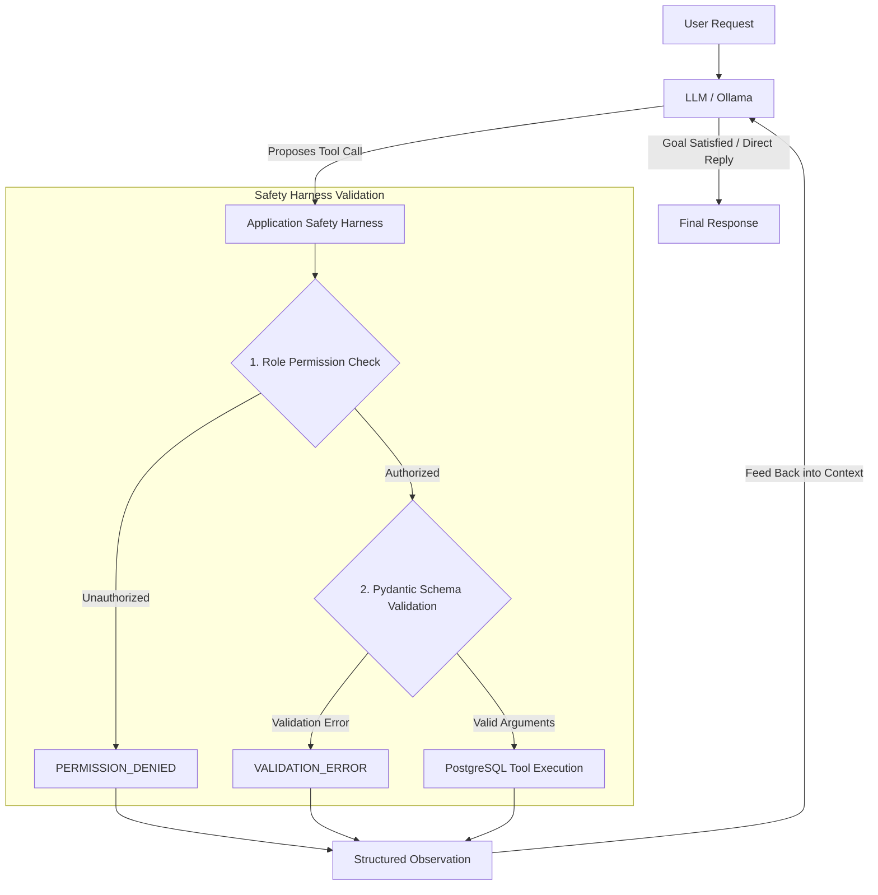

# Topic 07: Autonomous Safe Agent with Tool Integration

An autonomous e-commerce assistant application demonstrating the core agent loop, tool calling via explicit schemas, an application-level safety harness, and role-based permissions backed by a PostgreSQL database and Ollama.

---

## 1. Project Overview

This project implements an autonomous agent that assists users with e-commerce operations such as searching catalog items, placing orders, checking warehouse stock, and administrative inventory management.

### Core Architecture Principle
> **The model proposes actions, but the application decides whether each action is allowed to execute.**

Every proposed tool invocation is intercepted and validated by an application-level safety harness before any database queries run. Permissions and constraints are never left to prompt engineering alone.

---

## 2. Architecture & Agent Loop

The system executes a standard **Decision → Action → Observation** loop:



### Execution Lifecycle
1. **User Request:** The agent receives a natural language query from the interactive console.
2. **Model Decision:** The LLM evaluates conversation history and determines whether a tool is required or if it can respond directly.
3. **Safety Harness Interception (`harness.py`):**
   - **Role Check:** Verifies if the active role (`customer` or `admin`) is authorized to run the requested tool.
   - **Schema Validation:** Validates arguments against strict Pydantic models (`schemas.py`).
4. **Execution & Observation (`tools.py`):** Permitted tools run transactional queries against PostgreSQL. Results or structured errors are returned as observations.
5. **Context Feed & Iteration:** Observations are formatted as JSON and appended to the message context for the next model turn.
6. **Termination:** The loop concludes when the LLM generates a natural language response, or halts when `MAX_ITERATIONS = 5` is reached.

### Developer Logging
During execution, the agent prints clean developer logs to trace tool invocations and system observations:
```text
User > Buy 2 units of product 1
[action] calling buy_product with {'product_id': 1, 'quantity': 2}
[observation] {'status': 'SUCCESS', 'product_id': 1, 'purchased': 2, 'remaining_stock': 3}

[Agent] > You have successfully purchased 2 units of product 1. The remaining stock is 3.
```

---

## 3. Project Structure

```text
├── agent.py       # Agent control loop, Ollama dispatch, and observation management
├── config.py      # Environment variables, database config, system prompt, and RBAC rules
├── harness.py     # Application-level safety harness, authorization, and schema checks
├── main.py        # Interactive CLI console with role-switching commands
├── schemas.py     # Pydantic input validation models and constraint definitions
├── tools.py       # PostgreSQL database tool implementations and transactional logic
└── README.md      # Project documentation
```

---

## 4. Available Tools

The agent has access to 5 domain-specific tools backed by PostgreSQL:

| Tool Name | Parameters | Description |
|---|---|---|
| `search_products` | `query: str` | Searches products by keyword (case-insensitive) and returns item names, prices, and stock availability. |
| `buy_product` | `product_id: int`, `quantity: int` | Deducts stock inside a transactional lock (`FOR UPDATE`) to prevent race conditions. |
| `check_stock` | `product_id: int` | Retrieves exact warehouse inventory count for a specific product ID (Admin only). |
| `restock_product` | `product_id: int`, `amount: int` | Increases stock quantity for an existing product in the database (Admin only). |
| `delete_product` | `product_id: int` | Permanently removes a product record from the inventory (Admin only). |

---

## 5. Role-Based Access Control (RBAC)

Role permissions are strictly enforced in application code (`harness.py`), never trusted to prompt text alone.

| Tool | Customer | Admin |
|:---|:---:|:---:|
| `search_products` | Allowed | Allowed |
| `buy_product` | Allowed | Allowed |
| `check_stock` | Denied | Allowed |
| `restock_product` | Denied | Allowed |
| `delete_product` | Denied | Allowed |

If an unauthorized role requests an action, the safety harness immediately rejects execution and returns a structured `PERMISSION_DENIED` error:
```json
{
  "error": "PERMISSION_DENIED: Role 'customer' cannot run 'check_stock'."
}
```

---

## 6. Safety Controls & Guardrails

* **Input Validation:** Pydantic schemas in `schemas.py` enforce strict boundaries:
  - `product_id`: Must be a positive integer (`gt=0`).
  - `quantity`: Must be between 1 and 10 (`gt=0, le=10`).
  - `amount`: Restock quantity must be between 1 and 100 (`gt=0, le=100`).
* **Database Concurrency Protection:** `buy_product` locks the target row (`SELECT ... FOR UPDATE`) to prevent overselling or race conditions during concurrent orders.
* **Structured Error Handling:** Expected business failures (e.g. `INSUFFICIENT_STOCK`, `PERMISSION_DENIED`, missing items) return structured dictionaries instead of unhandled crashes.
* **Iteration Threshold:** Execution is bounded by `MAX_ITERATIONS = 5` in `config.py` to prevent infinite loops and runaway compute.

---

## 7. Configuration & Environment

Configuration is centralized in `config.py` and can be overridden via environment variables:

| Variable | Default Value | Description |
|---|---|---|
| `LLM_MODEL` | `qwen3:4b` | Ollama model identifier (e.g. `qwen2.5`, `qwen3:4b`, `llama3.1`) |
| `MAX_ITERATIONS` | `5` | Maximum turns in the agent tool loop |
| `DB_HOST` | `localhost` | PostgreSQL host address |
| `DB_PORT` | `5432` | PostgreSQL port |
| `DB_NAME` | `postgres` | Database name |
| `DB_USER` | `postgres` | Database username |
| `DB_PASSWORD` | `postgres` | Database password |

---

## 8. Setup & How to Run

### Prerequisites
* Python 3.10+
* PostgreSQL running locally
* [Ollama](https://ollama.ai/) installed and running with a tool-calling capable model:
  ```powershell
  ollama pull qwen3:4b
  # or: ollama pull qwen2.5
  # or: ollama pull llama3.1
  ```

### 1. Activate Virtual Environment
```powershell
.\.venv\Scripts\Activate.ps1
```

### 2. Install Dependencies
```powershell
pip install ollama pydantic psycopg2-binary
```

### 3. Initialize Database Table
Connect to PostgreSQL and create the `products` table with seed data:

```sql
CREATE TABLE products (
    id SERIAL PRIMARY KEY,
    name VARCHAR(255) NOT NULL,
    price NUMERIC(10, 2) NOT NULL,
    stock INT NOT NULL CHECK (stock >= 0)
);

INSERT INTO products (name, price, stock) VALUES
('MacBook Pro M3', 1999.00, 5),
('Wireless Mouse', 25.00, 15),
('Mechanical Keyboard', 85.00, 8),
('USB-C Adapter', 19.99, 0);
```

### 4. Launch Application
Start the interactive CLI session:

```powershell
python main.py
```

---

## 9. Interactive CLI Usage

When `main.py` is running, you can interact naturally with the agent, test authorization boundaries, or switch roles:

### Available Console Commands
* `role customer` - Switches active session role to customer (default).
* `role admin` - Switches active session role to administrator.
* `exit` or `quit` - Terminates the interactive session.

